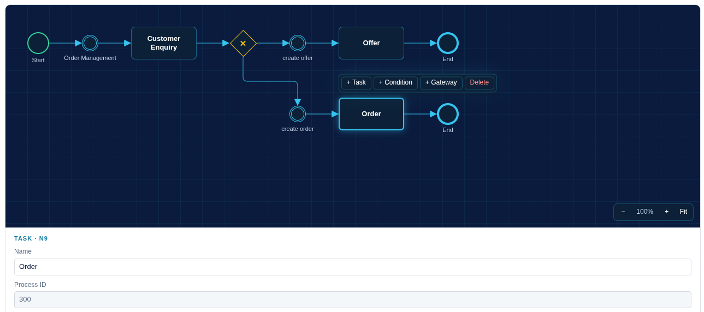

# Imixs-Diagram

A lightweight, dependency-free process modeler written in plain JavaScript.

Imixs-Diagram lets process managers build **meta models** for the [Imixs-Workflow](https://www.imixs.org) engine without knowing BPMN. The models are stored as real **BPMN 2.0** files that the engine executes directly, and that technical modelers can refine in [Open-BPMN](https://www.open-bpmn.org).



The editor is meant to be embedded in web applications, in particular Jakarta EE Faces applications such as [Imixs-Office-Workflow](https://doc.office-workflow.com/).

> **Status:** Pre-release. The meta model editor is usable; org chart and skill map are planned. APIs may still change.

## One model, two roles

- **Process managers** work in Imixs-Diagram. They only see tasks, events, gateways and a few structural actions. The layout is computed automatically, so there is nothing to arrange by hand.
- **Technical modelers** open the same `.bpmn` file in Open-BPMN and add what the engine needs: plugins, mail templates, rules and other `imixs:item`s on events and tasks.

Imixs-Diagram passes everything it does not understand through unchanged. So both roles can work on the same model alternately, and the process manager never breaks what the technical modeler configured.

## Features

- **Structured editing instead of drawing.** Users never draw edges by hand. They select an element and choose an action such as `+ Task`, `+ Gateway` or `Connect to…`. The diagram is derived from the structure.
- **Imixs semantics built in.** Every transition between two tasks is an event; the editor creates and removes events automatically.
- **Always meaningful.** Actions that would produce a wrong structure (e.g. task → task without event) are not offered. Unfinished parts (e.g. an event without target) are allowed while modeling and marked with a dashed yellow border.
- **Automatic layout and routing.** Left-to-right layered layout, orthogonal edges with rounded corners, arcs for loops.
- **BPMN 2.0 import / export** with automatic Imixs numbering (`processid`, `activityid`) and generated diagram interchange (DI), so the file opens in Open-BPMN.
- **Property panel** below the canvas for name, documentation, conditions and the model version.
- **Pan and zoom**: drag on empty space, mouse wheel zooms.
- **Themeable**: dark canvas, light property panel, all colors as CSS variables.
- **No dependencies, no build step**: plain ES modules that run directly in the browser.

## Org chart

Org charts use the same look and the same structured editing: units are laid out top-down, a parent centered above its children, and connected by orthogonal edges. The action bar of a unit offers `+ Child`, `+ Sibling`, `Edit`, `Delete` (the children move up) and `Delete Subtree`. There is no property panel: `Edit` or a double click fires `onOpen(node)`, so the host application can open its own form. Units created in the current session are marked with a dashed yellow border until the diagram is reloaded.

```js
const chart = createDiagram(element, {
    type: 'orgchart',
    nodes: [
        { id: 'ceo', type: 'unit', properties: { name: 'Management', description: 'Anna Example' } },
        { id: 'dev', type: 'unit', properties: { name: 'Development' } }
    ],
    edges: [{ id: 'e1', source: 'ceo', target: 'dev' }]
});
chart.onOpen(node => openForm(node.id));
```

The root is the unit without parent; it is always present and cannot be deleted. Without nodes, a new org chart with a root unit is created. See `demo/orgchart.html`.

## Skill map

Skill maps share the tree model of org charts (`type: 'skillmap'`, nodes of type `skill`) but look different: skills are glowing bubbles, and sub-skills are nested inside their parent bubble. Click a bubble to jump into it, click the background or press <kbd>Esc</kbd> to jump out; a breadcrumb shows the path. Below it, a toolbar adds sub-skills (`+ Child`) and skills on the same level (`+ Sibling`) to the focused bubble or the clicked skill, and `Edit` fires `onOpen(node)`. See `demo/skillmap.html`.

## Imixs meta models

Imixs-Workflow is an event-driven BPMN engine. A **task** is a state of a workflow instance; a transition between tasks is always an intermediate catch **event**, the trigger the engine waits for. In a meta model, each task is linked to a larger technical BPMN model, and its events trigger events there.

| Element                | Successor                                                       |
| ---------------------- | --------------------------------------------------------------- |
| Start                  | exactly one event (the init event)                              |
| Task                   | at most one: an event, a gateway, or an end (= final state)     |
| Gateway after a task   | every branch leads to an event                                  |
| Event                  | exactly one task (the same task = no state change) or a gateway |
| Gateway after an event | conditional flows with a condition, each leading to a task      |

Several events of one gateway may lead to the same task, e.g. "Approve with e-mail" and "Approve without e-mail".

### Modeling actions

| Selected            | Actions                                                                                                   |
| ------------------- | --------------------------------------------------------------------------------------------------------- |
| Task                | `+ Task` (event + task), `+ Condition` (event + conditional gateway), `+ Gateway`, `+ End`, `Connect to…` |
| Event               | `+ Task`, `+ Condition`, `Connect to…`                                                                    |
| Gateway after task  | `+ Event`, `Connect to…`                                                                                  |
| Conditional gateway | `+ Task`, `Connect to…`                                                                                   |
| Edge                | `+ Task` (inserts task and event), `Delete` (removes the branch)                                          |

Double click jumps to the name field, <kbd>Del</kbd> deletes the selection.

## Getting started

No build is required. Serve the repository with any static web server and open the demo page:

```bash
python3 -m http.server 8080
# or
npx serve .
```

Then open `http://localhost:8080/demo/`. The demo starts with a new model and can open and download `.bpmn` files.

ES modules need a web server; opening the files via `file://` does not work.

## Embedding

```html
<link rel="stylesheet" href="imixs-diagram/imixs-diagram.css" />
<div id="diagram" style="height: 640px"></div>

<script type="module">
  import { createDiagram } from "./imixs-diagram/index.js";

  // BPMN XML written by Imixs-Diagram, a JSON model, or nothing for a new model
  const diagram = createDiagram(document.getElementById("diagram"), bpmnXml);

  diagram.onChange(() => {
    // e.g. fill a hidden input field of a Faces form
    document.getElementById("model").value = diagram.getBPMN();
  });
</script>
```

| Function                      | Description                                                                    |
| ----------------------------- | ------------------------------------------------------------------------------ |
| `createDiagram(element, src)` | Creates the editor in `element`; throws if a BPMN file is rejected             |
| `getBPMN()`                   | Current model as BPMN 2.0 XML, ready to be saved                               |
| `getModel()`                  | Current model as plain JSON                                                    |
| `validate()`                  | Open points and errors: `[{ id, severity: 'error' \| 'incomplete', message }]` |
| `onChange(callback)`          | Called after every change of the model                                         |
| `onOpen(callback)`            | Called with a copy of a node on `Edit` or double click                         |
| `setProperty(id, key, value)` | Changes a property, e.g. the name of an org unit                               |

The host element contains the canvas (two thirds) and the property panel (one third); its height applies to both. An optional third argument `{ propertyPanel: false }` hides the panel. `getBPMN()` applies to meta models only.

### BPMN files

- Files are written with `exporter="imixs.meta.diagram"`. Only such files are accepted on import; other BPMN files are technical models and are rejected with a clear message. Open-BPMN keeps the exporter attribute when saving.
- On import, the diagram interchange (DI) is ignored and the automatic layout is applied. On export, DI is generated with the default sizes of Open-BPMN.
- Unknown attributes, `extensionElements` content and unknown child elements of every element, as well as further namespaces, `imixs:item`s and root elements such as `bpmn2:message`, are passed through unchanged.
- Flow elements a meta model does not know (e.g. a parallel gateway) and models with several processes are rejected.

### Theming

All colors are CSS variables on `.imixs-editor`, e.g.:

```css
.imixs-editor {
  --imixs-bg: #0a1b3d; /* canvas background */
  --imixs-accent: #35c4f0; /* edges, borders, selection */
  --imixs-panel-bg: #ffffff; /* property panel */
}
```

See `src/imixs-diagram.css` for the full list.

## Architecture

```
            ┌───────────────────────────────────────────────────────┐
 Host app   │ createDiagram() · getBPMN() · validate() · onChange() │  index.js
            └───────────────┬───────────────────────────▲───────────┘
                 BPMN XML   │                           │ BPMN XML
            ┌───────────────▼───────────────────────────┴───────────┐
            │ bpmn.js  fromBPMN() / toBPMN()   ·   xml.js           │
            └───────────────┬───────────────────────────────────────┘
            ┌───────────────▼───────────────────────────────────────┐
            │ model.js  JSON model, structure operations as         │
            │           transactions  ·  rules.js  Imixs rules      │
            └───────┬───────────────────────────────────────────────┘
                    │ change events
         ┌──────────▼───┐   ┌─────────────┐   ┌──────────────┐
         │ layout.js    │──►│ nodes.js    │   │ properties.js│
         │ auto layout  │   │ edges.js    │   │ panel        │
         └──────────────┘   │ router.js   │   └──────────────┘
                            └──────┬──────┘
                    ┌──────────────▼─────────────────┐
                    │ editor.js   selection, actions │
                    │ panzoom.js  · viewport.js      │
                    └────────────────────────────────┘
```

**Principles**

1. **The model is the single source of truth.** All user actions change the model; views re-render from it. Only selection and viewport are view state.
2. **Operations are transactions.** Each structure operation is applied, checked against the Imixs rules and rolled back if it would add an error. The editor only offers actions whose dry run succeeds.
3. **Nodes are HTML, edges are SVG.** Node sizes come from CSS only; the model stores positions, never sizes.
4. **Layout and routing are automatic.** The model stores only `source` and `target` of an edge.
5. **Pure logic is DOM-free.** Model, rules, layout, router, viewport, XML and BPMN run in Node and are covered by unit tests.

### Modules

| Module                  | Responsibility                                                |
| ----------------------- | ------------------------------------------------------------- |
| `src/index.js`          | Public API                                                    |
| `src/model.js`          | JSON model, structure operations, change events               |
| `src/rules.js`          | Imixs rules (`validate()`) and numbering (`assignImixsIds()`) |
| `src/bpmn.js`           | BPMN 2.0 import / export, new model template                  |
| `src/xml.js`            | Minimal XML parser and serializer                             |
| `src/layout.js`         | Layered layout (meta model)                                   |
| `src/tree.js`           | Tree layout and rules (org chart, skill map)                  |
| `src/pack.js`           | Circle packing layout (skill map)                             |
| `src/bubbles.js`        | Zoom navigation through skill map bubbles                     |
| `src/router.js`         | Orthogonal edge routing                                       |
| `src/nodes.js`          | Node rendering (HTML/CSS)                                     |
| `src/edges.js`          | Edge rendering (SVG)                                          |
| `src/editor.js`         | Selection, action bar, keyboard                               |
| `src/properties.js`     | Property panel                                                |
| `src/panzoom.js`        | Pan, zoom, zoom toolbar                                       |
| `src/viewport.js`       | Coordinate transforms for pan and zoom                        |
| `src/imixs-diagram.css` | Styling and theme variables                                   |

## Repository layout

```
src/     ES modules of the editor
demo/    playground pages (meta model editor, org chart, skill map)
test/    unit tests (node:test)
bpmn/    example BPMN files
```

## Tests

```bash
node --test
```

Requires Node.js 18 or newer.

## Roadmap

| Step | Scope                                       | Status |
| ---- | ------------------------------------------- | ------ |
| M0   | Project skeleton, JSON model with tests     | ✅     |
| M1   | Canvas with HTML nodes                      | ✅     |
| M2   | SVG edges with automatic routing            | ✅     |
| M3   | Structure operations, selection, delete     | ✅     |
| M4   | Property panel, public API                  | ✅     |
| M5   | Pan / zoom                                  | ✅     |
| –    | Imixs event semantics, BPMN 2.0 file format | ✅     |
| M6   | Tree layout, org chart                      | ✅      |
| M7   | Skill map, re-parent subtrees               |        |
| M8   | WebJar packaging, Jakarta Faces integration |        |

## Browser support

Current versions of Chrome, Firefox, Safari and Edge.

## License

Eclipse Public License 2.0, see [LICENSE](LICENSE).
